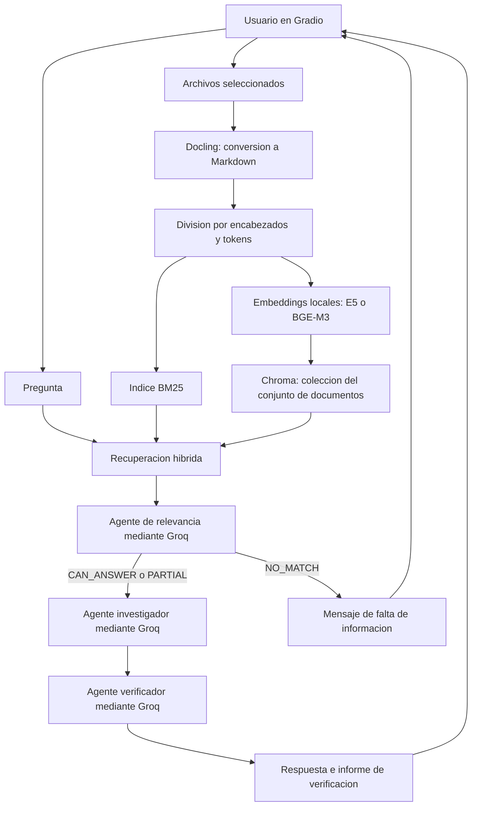

# DocChat / multiagents

**DocChat** es una aplicación para cargar documentos PDF, DOCX, TXT y Markdown,
hacer preguntas sobre su contenido y obtener una respuesta acompañada de un
informe de verificación. Puede utilizarse para consultar informes extensos,
manuales y documentos técnicos desde una interfaz web local.

Implementa **RAG** (generación aumentada con recuperación): convierte los archivos,
busca los fragmentos relacionados con la pregunta y los entrega a tres agentes
coordinados por LangGraph para evaluar su relevancia, redactar y verificar.
La verificación compara la respuesta con los fragmentos recuperados; su resultado
es una evaluación del modelo y requiere revisión cuando se necesita precisión.

La interfaz, la conversión, los embeddings y el índice se ejecutan en el equipo.
Los agentes envían la pregunta, los fragmentos recuperados y, al verificar, la
respuesta generada a **Groq**. Por tanto, se necesita conexión a Internet para
responder consultas, aunque los modelos de embeddings estén descargados.

El modelo de chat configurado por defecto es `openai/gpt-oss-20b`, servido por Groq,
con temperatura `0.5` y hasta `1024` tokens por llamada. Se configura en `.env`;
el cliente se construye en [`config/llm.py`](config/llm.py).

## Arquitectura



LangGraph define el orden de ejecución y una transición de verificación a
investigación cuando la condición de revisión del flujo se activa.

| Componente | Responsabilidad | Archivo principal |
| --- | --- | --- |
| Gradio | Carga de archivos, preguntas, resultados y estado de cada sesión. | [`app.py`](app.py) |
| Docling y divisores de texto | Conversión a Markdown, fragmentación y caché por contenido. | [`document_processor/file_handler.py`](document_processor/file_handler.py) |
| Embeddings locales | Vectores multilingües con Sentence Transformers y Hugging Face. | [`retriever/embeddings.py`](retriever/embeddings.py) |
| BM25 + Chroma | Búsqueda por términos y similitud semántica; combinación de resultados. | [`retriever/builder.py`](retriever/builder.py) |
| LangGraph | Estado y transiciones entre agentes. | [`agents/workflow.py`](agents/workflow.py) |
| Agente de relevancia | Decide si los fragmentos permiten responder completa o parcialmente. | [`agents/relevance_checker.py`](agents/relevance_checker.py) |
| Agente investigador | Redacta la respuesta utilizando los fragmentos recuperados. | [`agents/research_agent.py`](agents/research_agent.py) |
| Agente verificador | Evalúa respaldo, contradicciones y relevancia de la respuesta. | [`agents/verification_agent.py`](agents/verification_agent.py) |
| Configuración | Variables de entorno y construcción del cliente Groq. | [`config/settings.py`](config/settings.py), [`config/llm.py`](config/llm.py) |

Cada conjunto de documentos tiene una colección Chroma independiente. Al cambiar
los archivos se invalidan el buscador y los resultados de la sesión. Las consultas
usan los documentos seleccionados y no incorporan historial de conversación.

## Requisitos para ejecutar en local

- **Windows o Linux x86-64**. Los comandos siguientes están escritos para
  **PowerShell en Windows** y se ejecutan dentro de la carpeta `multiagents`.
- **Python 3.12** y **uv** para instalar las dependencias bloqueadas.
- Una cuenta en Groq y una **API key** válida para el modelo configurado.
- Internet para la instalación, la primera descarga de modelos y las consultas a Groq.
- CPU para el perfil inicial; una GPU NVIDIA compatible es opcional para CUDA.

Desde la raíz de `sisecmonitor`, entrar al proyecto:

```powershell
cd multiagents
```

## Python y dependencias

El proyecto usa **Python 3.12** (`>=3.12,<3.13`). `.python-version` selecciona
esa rama. Las dependencias directas se mantienen en `pyproject.toml` y el árbol
completo, incluidas sus versiones y hashes, en `uv.lock`.

Los perfiles soportados por el bloqueo son Windows y Linux x86-64:

- `cpu`: PyTorch `2.14.1+cpu` y torchvision `0.29.1+cpu`.
- `cuda`: PyTorch `2.14.1+cu130` y torchvision `0.29.1+cu130`, para una GPU y
  controlador NVIDIA compatibles con CUDA 13.0.

Estos perfiles son excluyentes. Seleccionar uno explícitamente al sincronizar
y ejecutar; `--all-extras` no corresponde a una instalación válida.
El perfil CPU se ha instalado y comprobado en Windows con Python 3.12.16.
El perfil CUDA se comprobó en una NVIDIA RTX A4000 de 16 GB: embeddings E5 y
conversión de tres páginas del informe ambiental de Google con Docling.

## Instalación con uv

**Paso 1.** Desde `multiagents`, instalar uv si no está disponible y preparar
el entorno CPU. `uv sync` crea `.venv` e instala las versiones de `uv.lock`:

```powershell
python -m pip install uv
uv python install 3.12
uv sync --locked --extra cpu
```

Para una instalación CUDA en `.venv`, sustituir el último comando por:

```powershell
uv sync --locked --extra cuda
```

En el entorno preparado en este workspace también existe una copia local de uv:
`./.tools/bin/uv.exe`. El intérprete 3.12 se descargó dentro de `.python/`, sin
reemplazar el Python global. La aplicación se ejecuta con `.venv/Scripts/python.exe`.

## Ejecutar con GPU NVIDIA

Para crear un entorno CUDA separado del entorno CPU en PowerShell:

```powershell
$env:UV_PROJECT_ENVIRONMENT = ".venv-cuda"
uv sync --locked --extra cuda
$env:EMBEDDING_DEVICE = "cuda"
uv run --locked --extra cuda python app.py
```

Completar primero la configuración de `.env` indicada en la sección siguiente.
`UV_PROJECT_ENVIRONMENT` selecciona dónde uv instala el entorno; ver la
[documentación de uv](https://docs.astral.sh/uv/concepts/projects/config/#project-environment-path).
El perfil CUDA utiliza PyTorch para CUDA 13.0 y requiere un controlador NVIDIA
compatible. Los perfiles `cpu` y `cuda` son excluyentes; no usar `--all-extras`.

En este workspace ya existe `.venv-cuda/`. Para utilizarlo, detener la instancia
actual y ejecutar desde esta carpeta, después de configurar la clave de Groq:

```powershell
$env:EMBEDDING_DEVICE = "cuda"
.\.venv-cuda\Scripts\python.exe app.py
```

Docling detecta CUDA automáticamente en este entorno. E5 utiliza la GPU mediante
`EMBEDDING_DEVICE`. El OCR RapidOCR mantiene procesamiento CPU porque el entorno
incluye ONNX Runtime sin proveedor CUDA; la aceleración no cubre todas las fases.
Para volver al entorno CPU con uv en la misma terminal:

```powershell
Remove-Item Env:UV_PROJECT_ENVIRONMENT -ErrorAction SilentlyContinue
$env:EMBEDDING_DEVICE = "cpu"
uv run --locked --extra cpu python app.py
```

También se puede usar directamente el intérprete de `.venv/`. Los resultados de las pruebas del PDF están en
[google-pdf-verification.md](docs/google-pdf-verification.md).

## Obtener el token del modelo y configurar `.env`

**Paso 2.** Obtener una **API key de Groq**. Es la credencial requerida por los
tres agentes, aunque el identificador del modelo comience por `openai/`.

1. Abrir [Groq Console](https://console.groq.com/) y crear una cuenta o iniciar sesión.
2. Entrar a [API Keys](https://console.groq.com/keys).
3. Pulsar **Create API Key**, asignar un nombre y completar la creación.
4. Copiar la clave generada y guardarla en el archivo `.env` del proyecto.
   En equipos compartidos de Groq, la creación requiere rol de propietario o desarrollador.

La [guía oficial de Groq](https://console.groq.com/docs/quickstart) explica la
creación de la clave y su uso mediante `GROQ_API_KEY`.

Crear `.env` desde la plantilla **solo si todavía no existe**, para conservar
las credenciales de una configuración anterior:

```powershell
if (-not (Test-Path .env)) {
    Copy-Item .env.example .env
}
notepad .env
```

Reemplazar el valor de ejemplo por la clave real de Groq en `.env`:

```dotenv
GROQ_API_KEY=tu-clave-de-groq
GROQ_MODEL=openai/gpt-oss-20b
GROQ_MAX_TOKENS=1024
EMBEDDING_MODEL=intfloat/multilingual-e5-small
EMBEDDING_DEVICE=cpu
GRADIO_SHARE=false
```

En `.env` la clave puede ir sin comillas, como en el ejemplo, o entre comillas
simples o dobles. Escribir el valor real en lugar de `tu-clave-de-groq`.
Conservar `.env.example` como plantilla sin credenciales; `.env` está excluido
por `.gitignore`.

La aplicación busca `.env` en la carpeta `multiagents`, independientemente
de la carpeta desde la que se ejecute. `.env.example` es solo una plantilla.
También se admiten variables de entorno. Groq clasifica, genera y verifica.
Los embeddings se calculan localmente; no necesitan claves de Gemini ni de
Hugging Face para estos modelos públicos. Una variable `GEMINI_API_KEY` antigua
se acepta por compatibilidad y no se utiliza. `.env.example` contiene únicamente
valores de ejemplo; conservar las claves reales en `.env`.

Para cambiar `GROQ_MODEL`, consultar el [catálogo de Groq](https://console.groq.com/docs/models)
y las [retiradas de modelos](https://console.groq.com/docs/deprecations), y comprobar
el acceso de la cuenta. Una clave válida no garantiza acceso a todos los modelos.
Para GPT-OSS se usa esfuerzo de razonamiento bajo y no se solicita el razonamiento
en la respuesta. El presupuesto se amplió para dejar espacio a la respuesta final.
Un fallo de acceso, cuota o conexión se muestra como error del proveedor;
no se convierte en un resultado de documento irrelevante.

### Token opcional de Hugging Face

Los embeddings predeterminados se descargan de un repositorio público. Si se desea
autenticar la descarga, crear un token con permiso de lectura en
[Hugging Face Tokens](https://huggingface.co/settings/tokens), siguiendo su
[documentación oficial](https://huggingface.co/docs/hub/security-tokens), y definirlo
en la terminal antes de ejecutar la aplicación:

```powershell
$env:HF_TOKEN = "tu-token-de-hugging-face"
```

Esta variable es opcional y la lee la biblioteca de Hugging Face. Configurarla en
el entorno de la terminal; el archivo `.env` de este proyecto valida las variables
de `Settings` y no declara `HF_TOKEN`.

## Embeddings y documentos grandes

Por defecto se utiliza **`intfloat/multilingual-e5-small`** con CPU. Admite
español y fragmentos de hasta 512 tokens. El documento completo puede ser mucho
mayor: se divide por encabezados y después por el tokenizer del modelo en
fragmentos de 448 tokens, con 64 de solapamiento. Se comprueba el tamaño de la
entrada completa para evitar recortes silenciosos. E5 recibe `passage: ` para
documentos y `query: ` para preguntas; los vectores se normalizan.

El modelo se descarga una vez en `.cache/models/` y se reutiliza en memoria.
Después de la descarga se puede ejecutar sin conexión para calcular embeddings;
las respuestas de los agentes siguen utilizando el servicio de Groq.

Para evaluar fragmentos más amplios, está disponible **`BAAI/bge-m3`**, con
licencia MIT, soporte multilingüe y una ventana de hasta 8192 tokens:

```dotenv
EMBEDDING_MODEL=BAAI/bge-m3
CHUNK_SIZE_TOKENS=1024
CHUNK_OVERLAP_TOKENS=128
EMBEDDING_BATCH_SIZE=4
```

BGE-M3 requiere más recursos y una descarga mayor. No necesita los prefijos de
E5. El perfil está configurado y sus opciones se comprueban en pruebas; no se ha
descargado ni medido su rendimiento en este equipo. E5 sí se ha ejecutado con
embeddings reales y consultas en español. La elección inicial favorece CPU;
no representa una comparación de precisión exhaustiva entre ambos modelos.

Para usar una GPU, instalar el perfil `cuda` y configurar
`EMBEDDING_DEVICE=cuda`. Reiniciar la aplicación al cambiar modelo o tamaños de
fragmento. La búsqueda mantiene la combinación BM25 + vectores densos; la
integración BGE de este proyecto no activa sus salidas sparse ni multi-vector.

## Ejecutar

**Paso 3.** Con las dependencias instaladas y `.env` configurado, iniciar en CPU:

```powershell
uv run --locked --extra cpu python app.py
```

Con el entorno ya instalado en Windows:

```powershell
.\.venv\Scripts\python.exe app.py
```

La interfaz está disponible en **http://127.0.0.1:5000**. Por defecto no solicita
un túnel público de Gradio. Para solicitar un enlace compartido, agregar
`GRADIO_SHARE=true` a `.env` y reiniciar la aplicación.

Si aparece `Could not create share link`, falló la creación del túnel público;
usar la dirección local. Ese mensaje por sí solo no identifica la causa de
red o del servicio. Configurar `GRADIO_SHARE=false` evita solicitar el túnel.
La primera conversión PDF puede descargar los modelos de Docling y requiere
acceso a sus repositorios de modelos. Las consultas a Groq requieren Internet.

### Consultar un documento

1. Abrir **http://127.0.0.1:5000** en el navegador.
2. Cargar uno o varios archivos en **Upload Documents**, o elegir un ejemplo y
   pulsar **Load Example**.
3. Escribir una pregunta, por ejemplo: `¿Sobre qué trata este documento?`.
4. Pulsar **Submit** y esperar la conversión, la indexación y las llamadas a Groq.
5. Revisar **Answer** y **Verification Report**. Las siguientes preguntas sobre
   los mismos archivos reutilizan el buscador de la sesión.

La primera ejecución puede tardar por las descargas y la conversión de documentos
grandes. Para consultar otro documento, reemplazar los archivos seleccionados.
Detener el servidor con **Ctrl+C**. Reiniciarlo después de cambiar `.env`.

### Problemas frecuentes

| Mensaje o síntoma | Acción |
| --- | --- |
| `GROQ_API_KEY: Field required` | Crear `multiagents/.env` y completar la clave; `.env.example` no se carga como configuración. |
| Groq devuelve `401` o `403` | Revisar la clave y los permisos de la cuenta para el modelo. |
| Groq devuelve `404` o `model_not_found` | Revisar `GROQ_MODEL` y seleccionar un identificador activo al que tenga acceso la cuenta. |
| Groq devuelve `429` | Esperar a que se restablezca el límite de uso y volver a consultar. |
| `Could not create share link` | Configurar `GRADIO_SHARE=false` y utilizar la URL local. |
| Hugging Face avisa de descargas sin autenticación | La descarga de estos modelos públicos puede continuar; para autenticarse, usar el token opcional de la sección anterior. |
| El puerto `5000` está ocupado | Detener la instancia anterior antes de iniciar otra; el puerto se define en `app.py`. |

## Organización de archivos

```text
multiagents/
├── app.py                  # Interfaz Gradio y estado de sesión
├── agents/                 # Agentes y flujo LangGraph
├── config/                 # Settings, constantes y cliente Groq
├── document_processor/     # Conversión y fragmentación con Docling
├── retriever/              # Embeddings y búsqueda híbrida
├── utils/                  # Registro de eventos
├── test/                   # Pruebas de integración y regresión
├── docs/                   # Análisis técnicos y resultados de verificaciones
├── .env.example            # Plantilla de configuración
├── pyproject.toml          # Dependencias y perfiles CPU/CUDA
└── uv.lock                 # Versiones y hashes bloqueados
```

Las carpetas `.venv/`, `.venv-cuda/`, `.cache/`, `.gradio/`, `chroma_db*/`,
`document_cache*/`, los logs y `.env` son datos locales excluidos de Git. `docs/`
contiene material de consulta para mantenimiento y no es necesario para ejecutar
la aplicación. Los dos PDF usados como ejemplos se encuentran en la raíz del proyecto.

## Verificación

```powershell
uv pip check
uv run --locked --extra cpu python -B -m unittest discover -s test -v
```

Las pruebas de integración usan las bibliotecas instaladas para convertir
documentos, trabajar con Chroma/BM25, construir Gradio y ejecutar LangGraph.
Las respuestas de Groq se simulan. Las pruebas de embeddings utilizan el modelo
E5 real desde la caché; descargarlo antes de ejecutar la suite por primera vez:

```powershell
uv run --locked --extra cpu python -c "from retriever.embeddings import get_embedding; get_embedding()"
```

Las pruebas se ejecutan con acceso a modelos sin conexión y también comprueban
fragmentación larga, conservación del final del documento, prefijos E5,
normalización y recuperación semántica básica en español.

## Actualizar y exportar requisitos

Editar las dependencias directas en `pyproject.toml`, resolver y validar:

```powershell
uv lock --upgrade
uv sync --locked --extra cpu
uv pip check
uv run --locked --extra cpu python -B -m unittest discover -s test -v
```

Los archivos `requirementsCPU.txt` y `requirementsCuda.txt` son exportaciones
generadas del bloqueo. Regenerarlos después de modificar dependencias:

```powershell
uv export --frozen --extra cpu --no-dev --no-emit-project --emit-index-url --output-file requirementsCPU.txt
uv export --frozen --extra cuda --no-dev --no-emit-project --emit-index-url --output-file requirementsCuda.txt
```

Con pip y un entorno Python 3.12, se pueden instalar con
`python -m pip install --require-hashes -r requirementsCPU.txt` o el archivo
CUDA correspondiente. El formato requirements exporta los índices de forma
global; uv conserva además la selección de índice por paquete y perfil.
